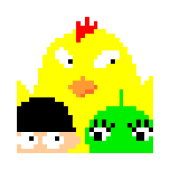

# MozPong - Web Port

A web port of **MozPong 1.0.5** by Akira Nagamatsu, aiming to reproduce the
original Mac OS Classic game as accurately as possible.

[](https://yqnn.github.io/mozpong-web-port/)

**Play it:** [https://yqnn.github.io/mozpong-web-port](https://yqnn.github.io/mozpong-web-port)

## About the original MozPong

**MozPong** is a mouse-controlled arcade game released in **1998** for Mac OS
System 7.1 and later. Move MozMoz-kun left and right, launch Butasan at the
eggs, catch the chicks, and work your way through 32 stages to meet the King of
Eggs.

The port is reconstructed from the original PowerPC code and resource fork.
The game logic runs at the original 30 Hz step, and the graphics, sounds,
welcome screen and high-score table are drawn from the original resources.

More details: see the original MozPong 1.0.5 manual and version history.

## Controls

- **Mouse**: move MozMoz-kun
- **Left click**: launch Butasan
- **S**: sound on/off
- **M**: BGM on/off
- **P**: pause/resume
- **Enter**: start a new game / resume

The side panel replaces the original Mac menus. **Abort** ends the current run
immediately and goes through the normal game-over/high-score flow. The
**Layout** option switches between the original 512×400 view and a portrait
mobile layout that moves the spinner, score and Butasan counters into a top
bar. On the mobile layout, dragging anywhere moves MozMoz with a 1.5× relative
multiplier and tapping anywhere outside the UI launches Butasan. Preferences,
unlocked stages and high scores are stored in `localStorage`.

The current run is also snapshotted to `localStorage` about once per second and
whenever the page is hidden. Reopening the page resumes that run in pause mode.
The snapshot is deleted when the run ends, when the high-score view opens, or
when a new game starts.


## Development

```sh
npm install
npm run dev      # development server
npm run build    # compiled site in docs/
npm run preview  # preview the production build
npm test         # headless game-logic smoke test
```

The production build is committed to `docs/` and is intended to be served by
GitHub Pages. It uses a relative Vite base, so the same build works from any
project path.

| Path | Purpose |
|---|---|
| `index.html`, `style.css` | shell, side panel and mobile bezel |
| `js/main.js` | boot, 30 Hz fixed-step loop, menus, high-score flow |
| `js/engine.js` | QuickDraw-style rects, Toolbox PRNG, sprite list, SAT run/collision/render |
| `js/resources.js` | classic Mac resource-fork parser and image loader |
| `js/game.js` | game globals and translated game functions |
| `js/audio.js` | Web Audio effects and the MUSL `snd 10000` theme |
| `public/assets/` | runtime resource fork, PNG/WAV assets and `manifest.json` |
| `tests/` | headless smoke tests |

### Accuracy notes

- The Toolbox `Random` generator uses the Park-Miller formula
  `seed = seed * 16807 mod (2^31-1)`, high 16 bits. The original never calls
  `SetRandSeed`, so its initial seed comes from the OS. This port starts at
  `seed = 1`; `rand.setSeed()` is available for a recorded replay seed. This
  is the one known source of frame-by-frame divergence.
- The original is 8-bit indexed; this port stores RGBA. PICT/cicn colours are
  taken from the original resource data and passed through the recovered Mac
  display gamma (`out = 255*(in/255)^0.6776`), which gives the softer
  reference palette.
- Sprites use the original 1-bit BW mask (`SATGetFacePP`'s third argument) as
  the transparency mask.

## Copyright

**Credits**

| Asset | Author | Licence |
| --- | --- | --- |
| original game, code and audio | Akira Nagamatsu | original MozPong terms |
| graphic art | Shizue Mouri | original MozPong terms |
| Sprite Animation Toolkit | Ingemar Ragnemalm | SAT 2.5.0 terms |
| Caveman Sound System | David Hay | original terms |

MozPong is free software by Akira Nagamatsu. The original application, manual
and licence terms are not part of this repository; the resource fork is
included only as the runtime data needed by the port.

## Licence

The port's source code is licensed under the **GNU Affero General Public
License, version 3**. See [LICENSE](./LICENSE).

The licence includes an additional term under Section 7: code generated by a
large language model or other generative system trained on this project is a
derivative work and is licensed under the same AGPL terms.

## Classic Mac game collection

<table>
<tr><td>
<a href="https://yqnn.github.io/tetris-max-web-port/"></a>
</td><td>
<a href="https://yqnn.github.io/jewelbox-web-port/"></a>
</td><td>
<a href="https://yqnn.github.io/mozpong-web-port/"></a>
</td></tr>
</table>
